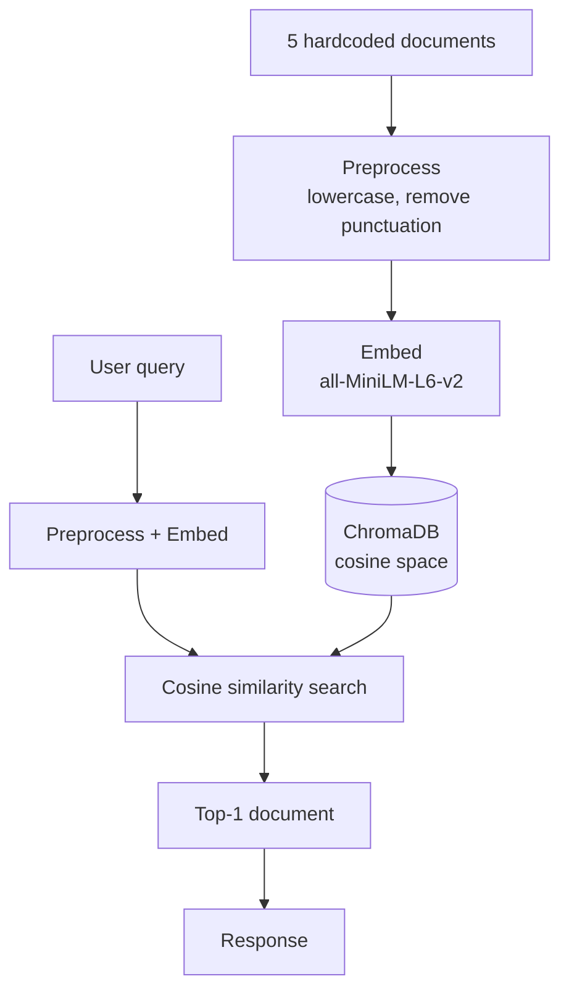

# Assessment 1: Mini RAG Pipeline (ChromaDB)

Finds the document most relevant to a user's question using embeddings and cosine similarity.

## Flow

## Steps

1. **Documents**: 5 short texts, hardcoded.
2. **Preprocess**: lowercase, strip punctuation.
3. **Embed**: `sentence-transformers` turns each text into a 384-number vector.
4. **Store**: vectors go into ChromaDB, set to cosine distance.
5. **Query**: the question gets the same preprocessing and embedding.
6. **Retrieve**: ChromaDB returns the closest document.
7. **Respond**: print that document with its similarity score.

## Run

1. Open `mini_rag_chromadb.ipynb` in Google Colab.
2. Run all cells.
3. Type a question when prompted, e.g. `Where is the Eiffel Tower?`

## Tools

`chromadb`, `sentence-transformers`
