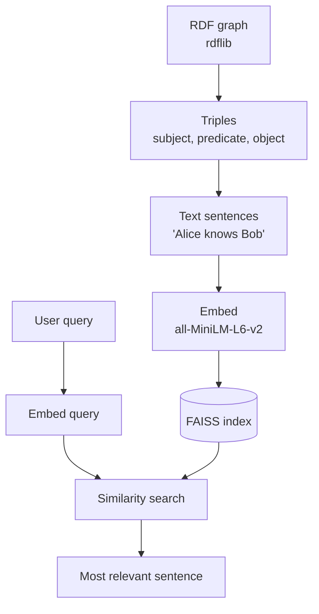

# Assessment 2: Knowledge Graph + Semantic Search

Stores facts as an RDF graph, turns them into sentences, and finds the sentence that best answers a question.

## Flow

## Steps

1. **Graph**: build triples with `rdflib` (Alice is a person, Alice knows Bob, Bob works at Acme Corp).
2. **Sentences**: each triple becomes plain text.
3. **Embed**: `sentence-transformers` converts each sentence to a vector.
4. **Store**: vectors go into a FAISS index.
5. **Query**: the question is embedded the same way.
6. **Answer**: FAISS returns the closest sentence.

## Run

1. Open `kg_semantic_search.ipynb` in Google Colab.
2. Run all cells.
3. Type a question, e.g. `Who does Alice know?`

## Tools

`rdflib`, `faiss-cpu`, `sentence-transformers`
